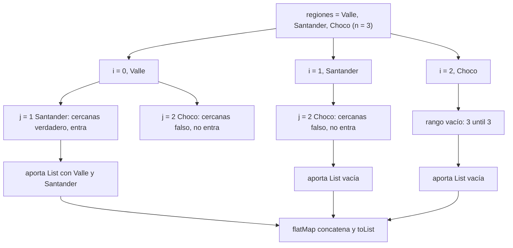
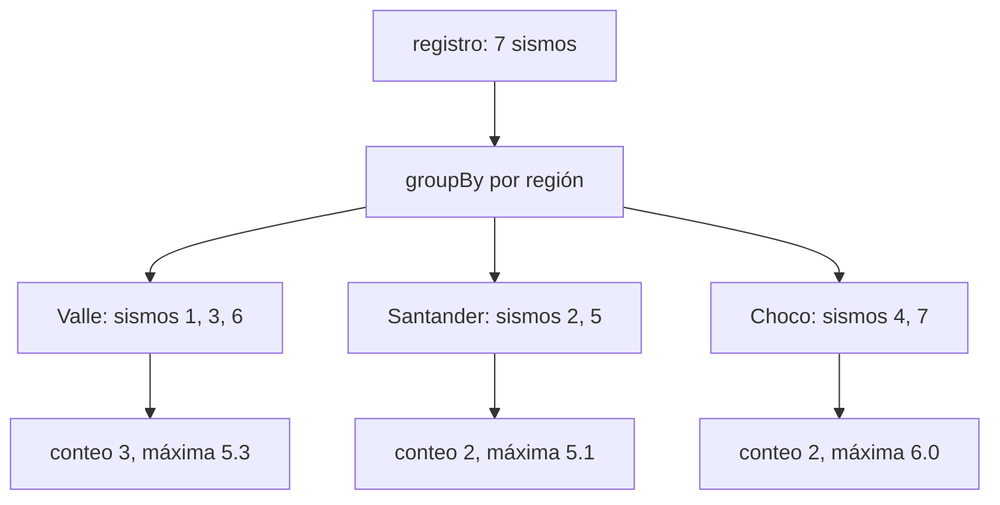
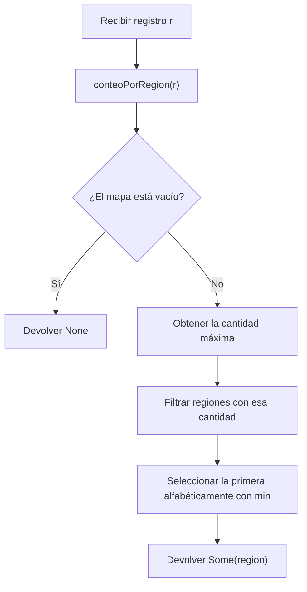
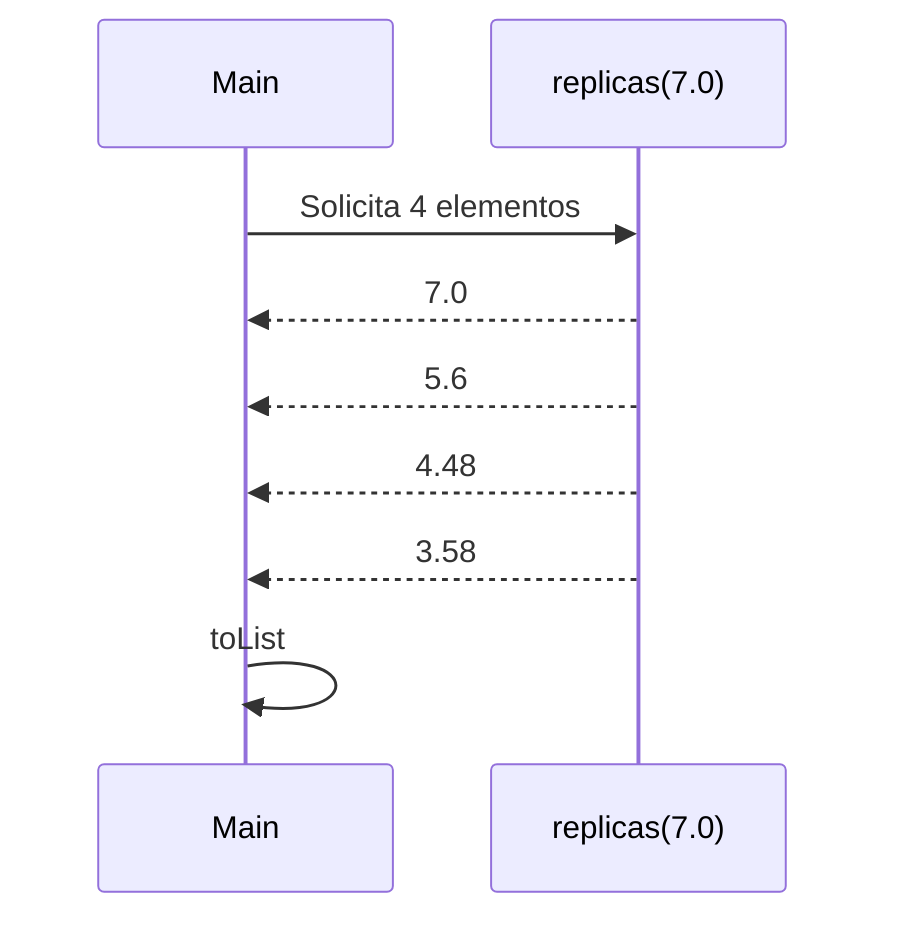
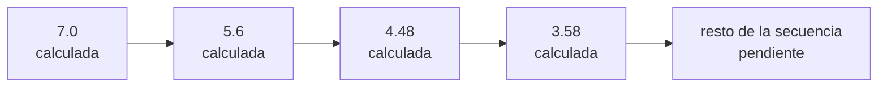
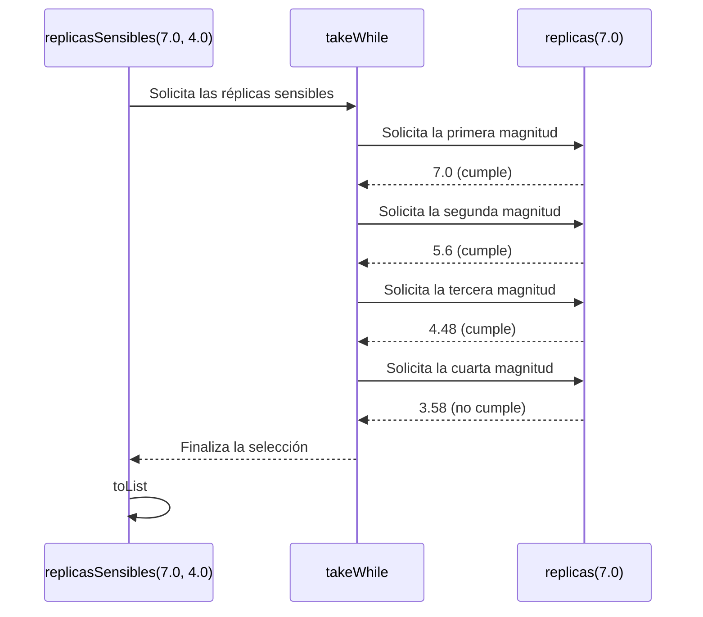
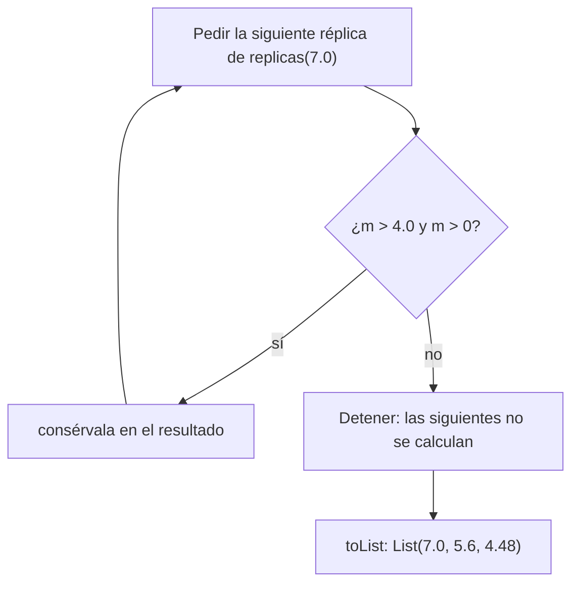
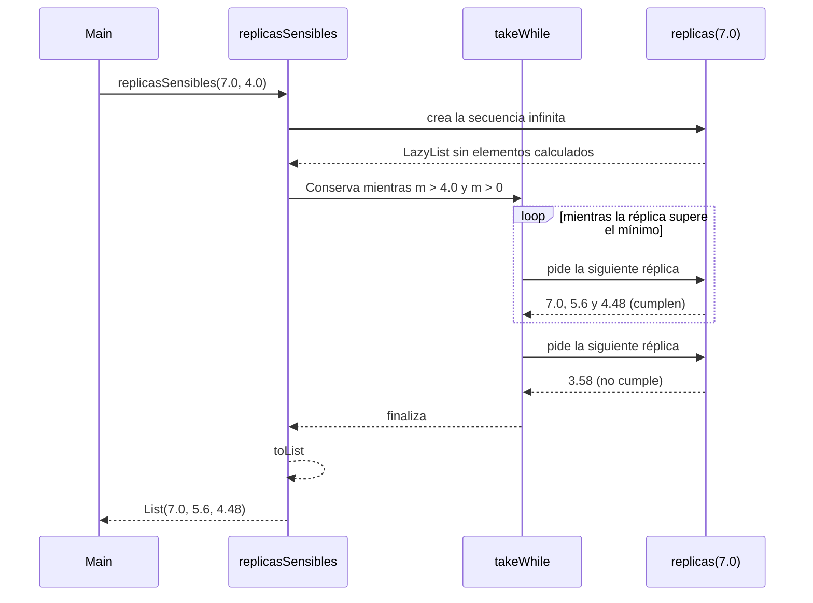
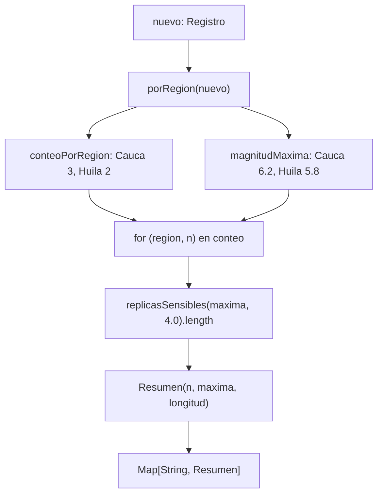
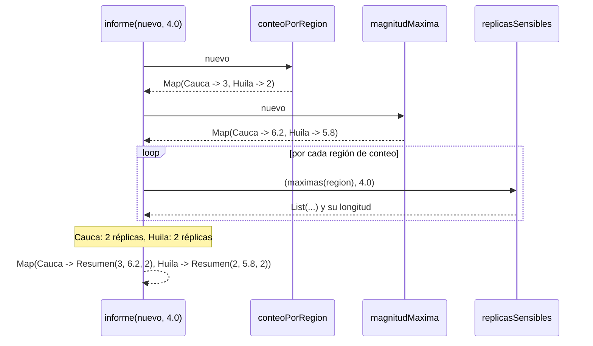

# Informe de proceso: Taller 3, registro sísmico

El Servicio Geológico publica un registro de sismos. Cada sismo trae 
su fecha, su región, su magnitud y su profundidad. En este taller se busca responder
las preguntas sobre ese registro describiendo **qué** se busca y no **cómo** recorrerlo:
con expresiones `for`, mapas y secuencias perezosas.

## Modelo de datos y registro de ejemplo 

```Scala
case class Fecha(anio: Int, mes: Int)
case class Sismo(fecha: Fecha, region: String, magnitud: Double, profundidad: Int)
type Registro = List[Sismo]
```
Todos los ejemplos usan este registro. Se numeran los sismos del 1 al 7 solo para poder 
referirse a ellos en las trazas.

| N.° | Región      | Magnitud |
|-----|-------------|----------|
| 1   | `Valle`     | 4.2      |
| 2   | `Santander` | 5.1      |
| 3   | `Valle`     | 3.8      |
| 4   | `Choco`     | 6.0      |
| 5   | `Santander` | 4.7      |
| 6   | `Valle`     | 5.3      |
| 7   | `Choco`     | 3.1      |

## Cómo traduce Scala una expresión `for`

Una expresión `for` con `yield` no es un ciclo: el compilador lo reescribe como llamadas a 
`map`, `flatMap` y `withFilter` antes de ejecutarla. Las reglas que se usan en este informe son tres:

| Forma del `for`                  | Se traduce a                       |
|----------------------------------|------------------------------------|
| `for (x <- e) yield f`           | `e.map(x => f)`                    |
| `for (x <- e if p) yield f`      | `e.withFilter(x => p).map(x => f)` |
| `for (x <- e1; y <- e2) yield f` | `e1.flatMap(x => e2.map(y => f))`  |

Dos aclaraciones sobre las reglas:

* El **último** generador se traduce a `map`; todos los anteriores, a `flatMap`.
* Una condición `if` se traduce a `withFilter`, que se comporta como `filter` pero **no 
 construye una lista intermedia**: guarda el predicado y lo aplica elemento por elemento mientras
 el `map` siguiente recorre la colección.

# Punto 1. Consultas con expresiones `for`

Las tres consultas parten del registro `r` y recorren sus sismos. Las dos primeras tienen un 
solo generador; la tercera combina varios.

## 1.1 `fuertes`

### Definición del algoritmo 

```Scala 
def fuertes(r: Registro, umbral: Double): List[String] =
 for (s <- r if s.magnitud > umbral) yield s.region
```

* `fuertes` recibe el registro `r` y un `umbral`, y devuelve la región de cada sismo cuya
magnitud **supera** el umbral.
* Las regiones salen en el orden en que aparecen en el registro y **sin quitar repetidos**:
si `Valle` tiene dos sismos fuertes, aparece dos veces. 
* La comparación es estricta (`>`): un sismo de magnitud exactamente igual al umbral no entra. 

### Explicación paso a paso

* `s <- r` toma los sismos de `r`, uno por uno y en orden.
* `if s.magnitud > umbral` descarta los que no superan el umbral.
* `yield s.region` entrega la región de cada sismo que pasó.

### Traducción del `for`

```Scala
r.withFilter(s => s.magnitud > umbral).map(s => s.region)
```

El `if` se vuelve `withFilter` y el `yield` se vuelve `map`. No hay `flatMap` porque solo hay un generador.

### Seguimiento de la ejecución

Se evalúa `fuertes(registro, 5.0)`. `map` recorre `r` una sola vez y, en cada sismo, el predicado de
`withFilter` decide si se transforma o se salta. 

| Sismo | Magnitud | `magnitud > 5.0` | Salida               |
|-------|----------|------------------|----------------------|
| 1     | 4.2      | no               | se salta             |
| 2     | 5.1      | sí               | agrega `"Santander"` |
| 3     | 3.8      | no               | se salta             |
| 4     | 6.0      | sí               | agrega `"Choco"`     |
| 5     | 4.7      | no               | se salta             |
| 6     | 5.3      | sí               | agrega `"Valle"`     |
| 7     | 3.1      | no               | se salta             |

Resultado: `List("Santander", "Choco", "Valle")`.

## 1.2 `enRegion`

### Definición del algoritmo

```scala
  def enRegion(r: Registro, region: String): List[Double] = 
  for (s <- r if s.region == region) yield s.magnitud
```

* `enRegion` devuelve las magnitudes de los sismos de una región, en el orden del registro.
* Tiene la misma forma de `fuertes`: cambian el predicado (`s.region == region`) y lo que se entrega
(`s.magnitud`).

### Traducción del `for`

```Scala 
  r.withFilter(s => s.region == region).map(s => s.magnitud)
```

### Seguimiento de la ejecución 

Con `enRegion(registro, "Valle")` pasan el `if` los sismos 1, 3 y 6, y el resultado es 
`List(4.2, 3.8, 5.3)`. Con `"Amazonas"` ningún sismo pasa el `if`, así que el resultado es `List()` sin 
necesidad de un caso especial. 

## 1.3 `paresCercanos`

### Definición del algoritmo 

```Scala
def paresCercanos(r: Registro, dif: Double): List[(String, String)] = {

  val regiones = (for (s <- r) yield s.region).distinct
  val n = regiones.length

  def cercanas(a: String, b: String): Boolean =
    r.exists(s1 => s1.region == a &&
      r.exists(s2 => s2.region == b &&
        Math.abs(s1.magnitud - s2.magnitud) <= dif + 1e-9))

  (for {
    i <- 0 until n
    j <- (i + 1) until n
    if cercanas(regiones(i), regiones(j))
  } yield (regiones(i), regiones(j))).toList
}
```

* Devuelve las parejas de regiones **distintas** con algún sismo cuya magnitud difiere a lo sumo `dif`
de algún sismo de la otra región. 
* Cada pareja sale **una sola vez** y las regiones van en el orden en que aparecen en el registro.

### Explicación paso a paso 

* **Regiones distintas:** `distinct` quita los repetidos y conserva la primera aparición de cada 
  región. `n` es la cantidad de regiones distintas. 
* **`cercanas(a, b)`:** responde si existe un sismo de `a` y uno de `b` con diferencia de magnitud
  menor o igual que `dif`. `exists` se detiene en el primer acierto; si no hay ninguno, recorre todo. 
* **Tolerancia `1e-9`:** las magnitudes son `Double` y la resta puede quedar un poco por encima del 
  valor exacto. Por ejemplo `Math.abs(5.1 - 5.3)` da `0.20000000000000018`, no `0.2`; sin la tolerancia, 
  `paresCercanos(registro, 0.2)` perdería la pareja `("Valle", "Santander")`.
* **Parejas sin repetir:** `j <- (i + 1) until n` recorre solo posiciones posteriores a `i`. Así
  nunca se empareja una región consigo misma y cada pareja no ordenada se visita una sola vez. 
* **`toList`:** un `for` sobre un `Range` produce una `IndexedSeq`, y la firma pide `List`.

### Traducción de los `for`

El de `regiones` tiene un solo generador, así que es un `map`:

```Scala
r.map(s => s.region).distinct
```

El principal tiene dos generadores y una condición:

```Scala
(0 until n).flatMap(i =>
  ((i + 1) until n)
    .withFilter(j => cercanas(regiones(i), regiones(j)))
    .map(j => (regiones(i), regiones(j)))
).toList
```
`i <- 0 until n` es un generador anterior, por eso es un `flatMap`: para cada `i` produce una colección de 
parejas y `flatMap` las concatena. `j <- (i + 1) until n` es el último generador, por eso es `map`, y el `if` 
queda como `withFilter` pegado a `j`.

### Seguimiento de la ejecución 

Se evalúa `paresCercanos(registro, 0.6)`. Las regiones de los sismos 1 a 7 son `Valle, Santander, Valle,
Choco, Santander, Valle, Choco`, y con `distinct`:

```scala
regiones = List("Valle", "Santander", "Choco") // n = 3
```
| `i` | `j`            | Pareja                 | `cercanas`   | ¿Entra? |
|-----|----------------|------------------------|--------------|---------|
| 0   | 1              | `Valle`, `Santander`   | verdadero    | sí      |
| 0   | 2              | `Valle`, `Choco`       | falso        | no      |
| 1   | 2              | `Santander`, `Choco`   | falso        | no      |
| 2   | (`3 until 3`)  | rango vacío            | no se llama  | —       |

`cercanas("Valle", "Santander")` busca en el orden del registro. El primer sismo de `Valle` es el 1
(4.2) y contra él se prueban los de `Santander`:

| `s1`    | `s2`    | Diferencia | ¿≤ 0.6? |
|---------|---------|------------|---------|
| 1 (4.2) | 2 (5.1) | 0.9        | no      |
| 1 (4.2) | 5 (4.7) | 0.5        | **sí**  |

Ambos `exists` se detienen ahí; el interno revisó los sismos de 1 a 5 (los que no son de `Santander` se 
descartan al comparar la región) y el externo paró en el sismo 1. Los otros dos casos no tienen acierto
y recorren todas las combinaciones: entre `Valle` y `Choco` la menor diferencia es 0.7 (3.8 con 3.1, y 
5.3 con 6.0), y entre `Santander` y `Choco` es 0.9 (5.1 con 6.0). Ambas superan 0.6.

`flatMap` junta lo que aportó cada `i`: `List(("Valle", "Santander"))`, `List()` y `List()`. Resultado:

```Scala
List(("Valle", "Santander"))
```

Con `dif = 1.0` las tres diferencias mínimas (0.2, 0.7 y 0.9) quedan dentro y salen las tres parejas, en 
el orden en que el `for` visita $(0,1)$, $(0,2)$ y $(1,2)$.

### Diagrama 

Muestra lo que aporta cada `i`. Dentro de cada `i`, `withFilter` y `map` trabajan sobre cada `j` sin 
lista intermedia. 



## Ejemplos de uso del punto 1

```Scala 
val rs = new RegistroSismico
val registro = Datos.registro

println(rs.fuertes(registro, 5.0))       // List(Santander, Choco, Valle)
println(rs.enRegion(registro, "Valle"))  // List(4.2, 3.8, 5.3)
println(rs.paresCercanos(registro, 0.6)) // List((Valle,Santander))
println(rs.paresCercanos(registro, 0.1)) // List()
```

## Conclusión del punto 1

Las tres consultas son expresiones `for` que el compilador reescribe como `map`, `flatMap` y `withFilter`.
`fuertes` y `enRegion` son un `withFilter` seguido de un `map`; `paresCercanos` añade un `flatMap` por el 
generador exterior, y el rango `(i + 1) until n` evita parejas repetidas. 


# Punto 2. Agrupar con mapas

## Definición del algoritmo 

```Scala
def porRegion(r: Registro): Map[String, List[Sismo]] =
  r.groupBy(s => s.region)

def conteoPorRegion(r: Registro): Map[String, Int] =
  porRegion(r).map { case (region, sismos) => (region, sismos.length) }

def magnitudMaxima(r: Registro): Map[String, Double] =
  porRegion(r).map { case (region, sismos) => (region, sismos.map(s => s.magnitud).max) }
```

## Explicación paso a paso

* **`porRegion`:** `groupBy` calcula la región de cada sismo y deja en la misma lista los que comparten 
  región. Dentro de cada lista los sismos conservan el orden que tenían en `r`. Una región ausente no
  aparece como llave, y con el registro vacío el resultado es `Map()`.
* **`conteoPorRegion`:** `map` sobre un `Map` recibe cada entrada como una pareja. El patrón 
  `{ case (region, sismos) => ...}` la descompone, y la entrada nueva es `(region, sismos.length)`. Como 
  `map` devuelve parejas, el resultado sigue siendo un `Map`.
* **`magnitudMaxima`:** igual que la anterior, pero el valor nuevo es la mayor magnitud:
  `sismos.map(s => s.magnitud)` saca las magnitudes y `.max` toma la mayor. `.max` falla con una lista
  vacía, pero aquí no puede pasar: `groupBy` solo crea una llave si hay al menos un sismo con esa región.

## Seguimiento de la ejecución 

Se evalúa con `registro`. `porRegion` reparte los sismos por su región, y las otras dos funciones 
transforman cada grupo:

| Llave       | Sismos (por número) | Magnitudes    | `conteoPorRegion` | `magnitudMaxima` |
|-------------|---------------------|---------------|-------------------|------------------|
| `Valle`     | 1, 3, 6             | 4.2, 3.8, 5.3 | 3                 | 5.3              |
| `Santander` | 2, 5                | 5.1, 4.7      | 2                 | 5.1              |
| `Choco`     | 4, 7                | 6.0, 3.1      | 2                 | 6.0              |

Los tres grupos son disjuntos y suman los 7 sismos del registro. 

Un `Map` no promete un orden de recorrido. Al imprimir, Scala puede mostrar las entradas en otro orden
(por ejemplo como `HashMap(...)`); no es un error, porque dos mapas con las mismas llaves y valores son
iguales sin importar el orden. Lo que sí queda garantizado es el orden de la lista de cada llave. 

## Diagrama 

Cada paso consume el resultado del anterior; no hay llamadas esperando.



## Ejemplos de uso del punto 2

```Scala
println(rs.conteoPorRegion(registro)) // Map(Valle -> 3, Santander -> 2, Choco -> 2)
println(rs.magnitudMaxima(registro))  // Map(Valle -> 5.3, Santander -> 5.1, Choco -> 6.0)
println(rs.conteoPorRegion(List()))   // Map()
```

## Conclusión del punto 2

`porRegion` agrupa con `groupBy`, y `conteoPorRegion` y `magnitudMaxima` transforman cada entrada con 
`map` sin recorrer listas a mano. Ninguna usa `for`, así que su ejecución se explica con `groupBy` y `map`.


# Punto 3. Consultas seguras

En este punto se implementan tres funciones que permiten consultar el registro sísmico de manera 
segura: `conteoSeguro`, `maximaDe` y `regionMasActiva`.

Estas funciones utilizan los mapas obtenidos en el punto 2 para consultar la cantidad de sismos, la magnitud máxima
y la región más activa. También contemplan los casos en que una región no existe o el registro está vacío. 

## 3.1 Función `conteoSeguro`

### Definición del algoritmo

```scala
  def conteoSeguro(r: Registro): Map[String, Int] = {
    conteoPorRegion(r).withDefaultValue(0)
  }
```
Devuelve un mapa con la cantidad de sismos de cada región y, si una región no aparece, devuelve `0` en vez
de generar un error.

### Explicación del código

- `Map[String, Int]`: Indica que el resultado es un mapa que relaciona el nombre de una región con su cantidad de sismos
- `conteoPorRegion(r):` Obtiene un mapa con las regiones y sus cantidades de sismos
- `withDefaultValue(0):` Establece el valor `0` para las regiones que no existen

Es importante saber que `withDefaultValue(0)` no agrega regiones nuevas al mapa, sino que permite consultarlas 
devolviendo cero.

### Funcionamiento paso a paso

La función `conteoPorRegion(r)` obtiene:

```scala
Map("Valle" -> 3, "Santander" -> 2, "Choco" -> 2)
```
Al usar `conteoSeguro`, las consultas producen:

| Región      | ¿Existe en el registro? | Resultado |
|-------------|-------------------------|-----------|
| `Valle`     | Sí                      | `3`       |
| `Santander` | Sí                      | `2`       |
| `Choco`     | Sí                      | `2`       |
| `Amazonas`  | No                      | `0`       |


### Ejemplo de uso

```scala
conteoSeguro(registro)("Valle") // 3
conteoSeguro(registro)("Amazonas") // 0
conteoSeguro(List())("Valle") // 0
```

Cuando el registro está vacío, `conteoPorRegion` devuelve `Map()`, pero `withDefaultValue(0)` permite seguir 
consultando cualquier región y obtiene `0`.

## 3.2 Función `maximaDe`

### Definición del algoritmo

```scala
  def maximaDe(r: Registro, region: String): Option[Double] = magnitudMaxima(r).get(region)
```

Busca la magnitud máxima de una región específica. Si la región no tiene sismos registrados, devuelve `None`.

### Explicación del código

- `magnitudMaxima(r)`: Genera un mapa con la magnitud más alta registrada en cada región
- `.get(region)`: Busca la región dentro del mapa y devuelve su valor si existe
- `Option[Double]`: Indica que la función puede devolver una magnitud o no encontrar ningún resultado
- `Some(valor)`: Representa que se encontró una magnitud
- `None`: Representa que la región no existe

En este caso, `.get(region)` se utiliza sobre un `Map`, permitiendo consultar una región sin acceder directamente 
a una clave que podría no existir.

### Funcionamiento paso a paso

Con el registro de ejemplo, `magnitudMaxima(r)` obtiene:

```scala
Map("Valle" -> 5.3, "Santander" -> 5.1, "Choco" -> 6.0)
```

Al consultar las regiones se obtienen los siguientes resultados:

| Región      | Magnitud máxima | Resultado   |
|-------------|-----------------|-------------|
| `Valle`     | `5.3`           | `Some(5.3)` |
| `Santander` | `5.1`           | `Some(5.1)` |
| `Choco`     | `6.0`           | `Some(6.0)` |
| `Amazonas`  | No registrada   | `None`      |


### Ejemplo de uso

```scala
maximaDe(registro, "Valle")     // Some(5.3)
maximaDe(registro, "Choco")     // Some(6.0)
maximaDe(registro, "Amazonas")  // None
maximaDe(List(), "Valle")       // None
```

Cuando la región existe, `.get(region)` devuelve `Some` con su magnitud máxima.
Si la región no está registrada o la lista está vacía, devuelve `None`.

## 3.3 Función `regionMasActiva`

### Definición del algoritmo

```scala
  def regionMasActiva(r: Registro): Option[String] = {
    val conteo = conteoPorRegion(r)
    if(conteo.isEmpty){
      None
    }
    else{
      val mayor = conteo.values.max
      Some(conteo.keys.filter(region => conteo(region) == mayor).min)
    }
  }
```
### Explicación del código

- `conteo.isEmpty`: Comprueba si el mapa está vacío
- `conteo.values.max`: Obtiene la mayor cantidad de sismos registrados
- `conteo.keys.filter(region => conteo(region) == mayor)`: Toma solamente las regiones con la misma cantidad máxima
- `.min`: Selecciona la primera región en orden alfabético si existe un empate
- `None`: Se devuelve cuando el registro está vacío
- `Some(...)`: Devuelve el nombre de la región seleccionada

Esta función identifica la región con mayor cantidad de sismos registrados. Si existen varias regiones con la 
misma cantidad máxima, selecciona la primera en orden alfabético y, cuando el registro está vacío devuelve `None`.  

La condición de `conteo.isEmpty` evita aplicar `.max` a un mapa vacío. Cuando el mapa contiene regiones, siempre 
existe al menos una con la cantidad máxima, por lo que también puede aplicarse `.min`.

### Funcionamiento paso a paso

Se usa el registro de ejemplo, que contiene siete sismos distribuidos en tres regiones.

Primero `conteo.values.max` obtiene la cantidad máxima:

```scala
val mayor = conteo.values.max // 3
```

Después `filter` selecciona la región que tiene esa cantidad:

```scala
conteo.keys.filter(region => conteo(region) == mayor)
// Selecciona "Valle"
```

Finalmente, `.min` selecciona la región correspondiente y `Some(...)` devuelve el resultado:

```scala
regionMasActiva(registro) // Some("Valle")
```

| Región      | Cantidad de sismos | ¿Cantidad máxima? |
|-------------|--------------------|-------------------|
| `Valle`     | `3`                | Sí                |
| `Santander` | `2`                | No                |
| `Choco`     | `2`                | No                |


### Caso de empate

Supongamos que tenemos un registro con estas cantidades:

| Región      | Cantidad de sismos | ¿Cantidad máxima? |
|-------------|--------------------|-------------------|
| `Valle`     | `2`                | Sí                |
| `Santander` | `2`                | Sí                |
| `Choco`     | `1`                | No                |

En este caso `filter` selecciona `Valle` y `Santander`, porque ambas tienen 2 sismos.
Después `.min` selecciona `Santander`, porque aparece antes que `Valle` en orden alfabético. 
El resultado es `Some("Santander")`.

### Caso de registro vacío

Si el registro está vacío, `conteoPorRegion(r)` devuelve `Map()` y la condición `conteo.isEmpty` es verdadera:

```scala
regionMasActiva(List()) // None
```

Por lo tanto, no se ejecutan las operaciones anteriores (`.max`, `.min`, etc.) devolviendo la función `None`.

### Diagrama de flujo

El siguiente diagrama muestra cómo la función decide qué resultado devolver.



## Ejemplos de uso del punto 3

```scala
println(rs.conteoSeguro(registro)("Valle")) // 3
println(rs.conteoSeguro(registro)("Amazonas")) // 0
println(rs.maximaDe(registro, "Choco")) // Some(6.0)
println(rs.maximaDe(registro, "Amazonas")) // None
println(rs.regionMasActiva(registro)) // Some(Valle)
println(rs.regionMasActiva(List())) // None
```

Las tres funciones usan los resultados del punto 2.

## Conclusión del punto 3

Las funciones `conteoSeguro`, `maximaDe` y `regionMasActiva` permiten consultar el registro sísmico de manera correcta, 
manejando regiones inexistentes, registros vacíos y los empates sin generar errores.


# Punto 4. `replicas` y `replicasSensibles`

Después de un sismo pueden producirse otros movimientos de menor magnitud, conocidos como réplicas. Para representar este
comportamiento se implementan las dos funciones: `replicas` genera una secuencia de magnitudes, y `replicasSensibles`
selecciona las que superan un mínimo establecido.

## 4.1 Código `replicas`

```Scala
  def redondear(x: Double): Double = Math.round(x * 100.0) / 100.0

  /** La secuencia infinita que empieza en la magnitud y multiplica por 0.8. */
  def replicas(magnitud: Double): LazyList[Double] =
    redondear(magnitud) #:: replicas(magnitud * 0.8)

```
La función genera una secuencia infinita que comienza con la magnitud del sismo original. Cada réplica
siguiente corresponde al 80% de la magnitud anterior y se presenta con dos decimales.

Para generar esta secuencia se utiliza `LazyList`, que permite calcular los elementos únicamente cuando se necesitan.

### Explicación del código

* `redondear(magnitud)`: deja la magnitud con solo dos decimales: por ejemplo `3.584` pasa a `3.58`. Esta función ya estaba proporcionada
en el material del profesor y hace falta para dar cada magnitud con la precisión que pide el enunciado.
* `#::`: agrega un elemento al inicio de una `LazyList`, dejando pendiente el cálculo de la secuencia siguiente.
* `replicas(magnitud * 0.8)`: realiza la llamada recursiva utilizando el 80% de la magnitud actual.

Es importante que la llamada recursiva utilice la magnitud sin redondear. De esta manera se conserva la precisión del
cálculo y se evita que la secuencia se estanque en valores pequeños: si se redondeara en cada paso, `0.02 * 0.8 = 0.016` volvería a redondearse a `0.02`
 y las réplicas quedarían fijas en ese valor.

### Funcionamiento paso a paso

Para observar el comportamiento de la función se utiliza una magnitud inicial de `7.0`.

| Paso | Operación | Valor exacto | Se muestra | ¿Lo calcula `take(4)`? |
|---|---|---|---|---|
| 1 | Magnitud inicial | `7.0` | `7.0` | sí |
| 2 | `7.0 * 0.8` | `5.6` | `5.6` | sí |
| 3 | `5.6 * 0.8` | `4.48` | `4.48` | sí |
| 4 | `4.48 * 0.8` | `3.584` | `3.58` | sí |
| 5 | `3.584 * 0.8` | `2.8672` | `2.87` | no |

### Ejemplo de uso

```Scala
replicas(7.0).take(4).toList
```
### Resultado

```Scala
List(7.0, 5.6, 4.48, 3.58)

```
`take(4)` limita la secuencia a cuatro elementos y `toList` permite obtenerlos como una lista convencional.

### Diagrama de llamados



### Diagrama de celda

Muestra qué parte de la secuencia existe después de `take(4)`.



## 4.2 Función `replicasSensibles`

Esta función selecciona las réplicas cuya magnitud supera un mínimo establecido. Recibe la magnitud inicial del sismo y el
valor mínimo, y devuelve una lista con las réplicas que cumplen esa condición.

### Código

```Scala
  /** Las réplicas mientras superen el mínimo, incluida la primera. */
  def replicasSensibles(magnitud: Double, minimo: Double): List[Double] =
    replicas(magnitud).takeWhile(m => m > minimo && m > 0).toList
```

### Explicación del código

* `replicas(magnitud)`: genera la secuencia de magnitud del sismo.
* `takeWhile`: conserva los elementos mientras cumplan la condición y detiene el recorrido cuando encuentra el primero que no la cumple.
* `m > minimo`: comprueba que la magnitud sea estrictamente superior al mínimo establecido.
* `m > 0`: solo tiene efecto cuando el mínimo es negativo. En ese caso toda réplica superaría el mínimo y la secuencia,
que decrece hacia cero, nunca fallaría la condición: con `m > 0` el recorrido se detiene cuando las réplicas se redondean a `0.0`.
* `toList`: convierte las magnitudes seleccionadas en una lista.

* `takeWhile` se usa en lugar de `filter` porque `filter` seguiría buscando elementos en el resto de la secuencia infinita,
mientras que `takeWhile` se detiene en el primero que no cumple.

### Funcionamiento paso a paso

Se utiliza como ejemplo un sismo de magnitud 7.0 y un mínimo de 4.0.

| Paso | Magnitud | ¿Supera el mínimo? | Acción |
|---|---|---|---|
| 1 | 7.0 | Sí | Se conserva. |
| 2 | 5.6 | Sí | Se conserva. |
| 3 | 4.48 | Sí | Se conserva. |
| 4 | 3.58 | No | Se detiene el recorrido. |


### Ejemplo de uso

```Scala
replicasSensibles(7.0, 4.0)
```
Resultado:

```Scala
List(7.0, 5.6, 4.48)
```
Si la magnitud inicial no supera el mínimo, como ocurre en el siguiente ejemplo:

```Scala
replicasSensibles(3.0, 4.0)
```
Resultado:

```Scala
List()
```
### Diagrama de llamados


### Diagrama de decisión
Cada paso pide la siguiente réplica y decide si se conserva o si el recorrido termina.



## 4.3 Evaluación perezosa de LazyList
La secuencia generada por `replicas` es infinita, por lo que no es posible calcular todos sus elementos.

Para solucionar esto se utiliza `LazyList`, que permite aplazar los cálculos hasta que se solicitan los elementos.

En esta implementación: 

* `replicas(7.0)` crea la secuencia sin recorrerla.
* `take(4)` limita la cantidad de elementos solicitados.
* `toList`: fuerza la evaluación de los cuatro elementos.

Por ejemplo, al ejecutar `replicasSensibles(7.0, 4.0)`, se conservan tres magnitudes, pero se evalúa una cuarta para comprobar que ya no supera el mínimo.
Esto permite trabajar con una secuencia infinita sin necesidad de recorrerla completamente.

Se comprobó con un contador sobre una copia de `replicas`:

| Llamada | Devuelve | Magnitudes calculadas |
|---|---|---|
| `replicas(7.0)`, recién creada | nada | 0 |
| `replicas(7.0).take(4).toList` | 4 | 4 |
| `replicasSensibles(7.0, 4.0)` | 3 | 4 |
| `replicasSensibles(9.0, 4.0)` | 4 | 5 |
| `replicasSensibles(3.0, 4.0)` | 0 | 1 |

### Diagrama de llamados de `replicas` y `replicasSensibles`



## Conclusión del punto 4

`replicas` construye una secuencia infinita de réplicas con `#::`.
Como `LazyList` solo calcula los elementos que se le piden, el programa no se queda en un ciclo.

`replicasSensibles` toma de esa secuencia, con `takeWhile`, las réplicas que son mayores que el mínimo y 
que 0 y las convierte en una `List` con `toList`. 
Las réplicas no aumentan y terminan en 0, así que en algún momento una de ellas incumple la condición: ahí `takeWhile` se detiene y el resultado es una lista finita. La
condición `m > 0` asegura que el cálculo termine incluso cuando el mínimo es negativo.


# Punto 5. `informe`
La función `informe` resume los sismos de cada región en una ficha con tres datos: cuántos sismos se
registraron, cuál fue la mayor magnitud y cuántas réplicas sensibles se esperan del sismo más fuerte de esa región. La ficha
es un `Resumen`, y el resultado es un mapa que asocia cada región con su ficha.


## 5.1 Función `informe`

```Scala
  def informe(r: Registro, minimo: Double): Map[String, Resumen] = {
    val conteo = conteoPorRegion(r)
    val maximas = magnitudMaxima(r)
    for ((region, n) <- conteo)
      yield (region, Resumen(n, maximas(region), replicasSensibles(maximas(region), minimo).length))
  }
```

### Explicación del código

* `conteoPorRegion(r)`: obtiene cuántos sismos hubo en cada región del punto 2.
* `magnitudMaxima(r)`: obtiene la mayor magnitud de cada región del punto 2. Ambos mapas salen de `porRegion(r)`, por lo que tienen las mismas regiones y
 `maximas(region)` nunca lanza excepción.
* `for ((region, n) <- conteo) yield...`: recorre cada región con su conteo y construye su ficha. Como el resultado son parejas `(region, Resumen(...))`,
 el `for` produce un `Map[String, Resumen]`.
* `replicasSensibles(maximas(region), minimo).length`: calcula las réplicas sensibles del sismo más fuerte de la región y
   cuenta cuántas hay (punto 4).

## 5.2 En qué se traduce la expresión `for`

El `for` de `informe` tiene un solo generador, así que por la tabla de inicio se traduciría a `map`. Pero este generador 
usa un patrón, `(region, n)`, y en ese caso el compilador agrega antes un `withFilter` que comprueba que cada entrada lo cumpla. Por eso 
queda un `withFilter` seguido de un `map`.

El siguiente bloque **no forma parte del código**: es una versión simplificada de lo que genera el compilador.

```Scala
 // Generado por el compilador a partir del `for` de `informe` (no está en el archivo)
conteo
.withFilter { case (region, n) => true; case _ => false }
.map {case (region, n) =>
  (region, Resumen(n, maximas(region), replicasSensibles(maximas(region), minimo).length))}
```

* `map` corresponde a la regla de un generador con `yield`.
* `withFilter` aparece porque el generador usa un patrón `(region, n)` y el compilador comprueba que cada entrada lo cumpla.
Toda entrada de un `Map` es una pareja, de modo que la comprobación siempre es verdadera y no descarta nada.

## 5.3 Funcionamiento paso a paso

Se utiliza como ejemplo un registro de cinco sismos en dos regiones y un mínimo de `4.0`.

```Scala
val nuevo = List(
  Sismo(Fecha(2026, 1), "Cauca", 4.4, 12),
  Sismo(Fecha(2026, 2), "Huila", 5.8, 70),
  Sismo(Fecha(2026, 2), "Cauca", 6.2, 33),
  Sismo(Fecha(2026, 3), "Huila", 3.9, 15),
  Sismo(Fecha(2026, 3), "Cauca", 3.3, 20))

```

| Región | Sismos | Magnitud máxima | Réplicas que superan 4.0 | cuántas | Primera que falla |
|---|---|---|---|---|---|
| `Cauca` | 3 | `6.2` | `6.2, 4.96` | 2 | `3.97` |
| `Huila` | 2 | `5.8` | `5.8, 4.64` | 2 | `3.71` |

### Ejemplo de uso

```Scala
informe(nuevo, 4.0)
```
### Resultado

```Scala
Map("Cauca" -> Resumen(3, 6.2, 2), "Huila" -> Resumen(2, 5.8, 2))

```
Si el registro está vacío, `porRegion` devuelve un mapa vacío, el `for` no tiene entradas que recorrer y el resultado es `Map()`.

### Diagrama de flujo de datos
Muestra cómo se combinan los puntos anteriores hasta formar el mapa final.


### Diagrama de llamados



## Conclusión del punto 5
`informe` reúne los resultados de los puntos anteriores. Con un `for` recorre el mapa de `conteoPorRegion` y,
para cada región, construye un `Resumen` con su número de sismos, su magnitud máxima (`magnitudMaxima`) y cuántas réplicas 
sensibles se esperan del sismo más fuerte de la región (`replicasSensibles`). El resultado es un `Map` con una entrada 
por cada región del registro.
