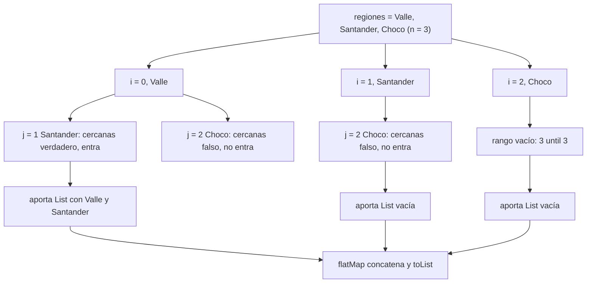
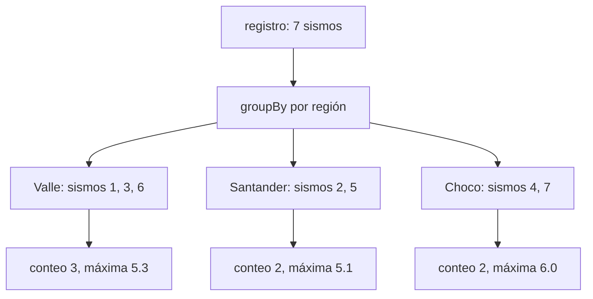

# Informe de proceso: Taller 3, registro sísmico

El Servicio Geológico publica un registro de sismos. Cada sismo trae 
su fecha, su región, su magnitud y su profundidad. En este taller se busca responder
las preguntas sobre ese registro describiendo **qué** se busca y no **cómo** recorrerlo:
con expresiones `for`, mapas y secuencias perezosas.

## Modelo de datos y registro de ejemplo 

```Scala
case class Fecha(anio: Int, mes: Int)
case class Sismo(fecha: Fecha, region: String, magnitud: Double, profundidad: Int)
type Registro = List[Sismo]
```
Todos los ejemplos usan este registro. Se numeran los sismos del 1 al 7 solo para poder 
referirse a ellos en las trazas.

| N.° | Región      | Magnitud |
|-----|-------------|----------|
| 1   | `Valle`     | 4.2      |
| 2   | `Santander` | 5.1      |
| 3   | `Valle`     | 3.8      |
| 4   | `Choco`     | 6.0      |
| 5   | `Santander` | 4.7      |
| 6   | `Valle`     | 5.3      |
| 7   | `Choco`     | 3.1      |

## Cómo traduce Scala una expresión `for`

Una expresión `for` con `yield` no es un ciclo: el compilador lo reescribe como llamadas a 
`map`, `flatMap` y `withFilter` antes de ejecutarla. Las reglas que se usan en este informe son tres:

| Forma del `for`                  | Se traduce a                       |
|----------------------------------|------------------------------------|
| `for (x <- e) yield f`           | `e.map(x => f)`                    |
| `for (x <- e if p) yield f`      | `e.withFilter(x => p).map(x => f)` |
| `for (x <- e1; y <- e2) yield f` | `e1.flatMap(x => e2.map(y => f))`  |

Dos aclaraciones sobre las reglas:

* El **último** generador se traduce a `map`; todos los anteriores, a `flatMap`.
* Una condición `if` se traduce a `withFilter`, que se comporta como `filter` pero **no 
 construye una lista intermedia**: guarda el predicado y lo aplica elemento por elemento mientras
 el `map` siguiente recorre la colección.

# Punto 1. Consultas con expresiones `for`

Las tres consultas parten del registro `r` y recorren sus sismos. Las dos primeras tienen un 
solo generador; la tercera combina varios.

## 1.1 `fuertes`

### Definición del algoritmo 

```Scala 
def fuertes(r: Registro, umbral: Double): List[String] =
 for (s <- r if s.magnitud > umbral) yield s.region
```

* `fuertes` recibe el registro `r` y un `umbral`, y devuelve la región de cada sismo cuya
magnitud **supera** el umbral.
* Las regiones salen en el orden en que aparecen en el registro y **sin quitar repetidos**:
si `Valle` tiene dos sismos fuertes, aparece dos veces. 
* La comparación es estricta (`>`): un sismo de magnitud exactamente igual al umbral no entra. 

### Explicación paso a paso

* `s <- r` toma los sismos de `r`, uno por uno y en orden.
* `if s.magnitud > umbral` descarta los que no superan el umbral.
* `yield s.region` entrega la región de cada sismo que pasó.

### Traducción del `for`

```Scala
r.withFilter(s => s.magnitud > umbral).map(s => s.region)
```

El `if` se vuelve `withFilter` y el `yield` se vuelve `map`. No hay `flatMap` porque solo hay un generador.

### Seguimiento de la ejecución

Se evalúa `fuertes(registro, 5.0)`. `map` recorre `r` una sola vez y, en cada sismo, el predicado de
`withFilter` decide si se transforma o se salta. 

| Sismo | Magnitud | `magnitud > 5.0` | Salida               |
|-------|----------|------------------|----------------------|
| 1     | 4.2      | no               | se salta             |
| 2     | 5.1      | sí               | agrega `"Santander"` |
| 3     | 3.8      | no               | se salta             |
| 4     | 6.0      | sí               | agrega `"Choco"`     |
| 5     | 4.7      | no               | se salta             |
| 6     | 5.3      | sí               | agrega `"Valle"`     |
| 7     | 3.1      | no               | se salta             |

Resultado: `List("Santander", "Choco", "Valle")`.

## 1.2 `enRegion`

### Definición del algoritmo

```scala
def enRegion(r: Registro, region: String): List[Double] = 
for (s <- r if s.region == region) yield s.magnitud
```

* `enRegion` devuelve las magnitudes de los sismos de una región, en el orden del registro.
* Tiene la misma forma de `fuertes`: cambian el predicado (`s.region == region`) y lo que se entrega
(`s.magnitud`).

### Traducción del `for`

```Scala 
r.withFilter(s => s.region == region).map(s => s.magnitud)
```
### Seguimiento de la ejecución 

Con `enRegion(registro, "Valle")` pasan el `if` los sismos 1, 3 y 6, y el resultado es 
`List(4.2, 3.8, 5.3)`. Con `"Amazonas"` ningún sismo pasa el `if`, así que el resultado es `List()` sin 
necesidad de un caso especial. 

## 1.3 `paresCercanos`

### Definición del algoritmo 

```Scala
def paresCercanos(r: Registro, dif: Double): List[(String, String)] = {

  val regiones = (for (s <- r) yield s.region).distinct
  val n = regiones.length

  def cercanas(a: String, b: String): Boolean =
    r.exists(s1 => s1.region == a &&
      r.exists(s2 => s2.region == b &&
        Math.abs(s1.magnitud - s2.magnitud) <= dif + 1e-9))

  (for {
    i <- 0 until n
    j <- (i + 1) until n
    if cercanas(regiones(i), regiones(j))
  } yield (regiones(i), regiones(j))).toList
}
```

* Devuelve las parejas de regiones **distintas** con algún sismo cuya magnitud difiere a lo sumo `dif`
de algún sismo de la otra región. 
* Cada pareja sale **una sola vez** y las regiones van en el orden en que aparecen en el registro.

### Explicación paso a paso 

* **Regiones distintas:** `distinct` quita los repetidos y conserva la primera aparición de cada 
  región. `n` es la cantidad de regiones distintas. 
* **`cercanas(a, b)`:** responde si existe un sismo de `a` y uno de `b` con diferencia de magnitud
  menor o igual que `dif`. `exists` se detiene en el primer acierto; si no hay ninguno, recorre todo. 
* **Tolerancia `1e-9`:** las magnitudes son `Double` y la resta puede quedar un poco por encima del 
  valor exacto. Por ejemplo `Math.abs(5.1 - 5.3)` da `0.20000000000000018`, no `0.2`; sin la tolerancia, 
  `paresCercanos(registro, 0.2)` perdería la pareja `("Valle", "Santander")`.
* **Parejas sin repetir:** `j <- (i + 1) until n` recorre solo posiciones posteriores a `i`. Así
  nunca se empareja una región consigo misma y cada pareja no ordenada se visita una sola vez. 
* **`toList`:** un `for` sobre un `Range` produce una `IndexedSeq`, y la firma pide `List`.

### Traducción de los `for`

El de `regiones` tiene un solo generador, así que es un `map`:

```Scala
r.map(s => s.region).distinct
```

El principal tiene dos generadores y una condición:

```Scala
(0 until n).flatMap(i =>
  ((i + 1) until n)
    .withFilter(j => cercanas(regiones(i), regiones(j)))
    .map(j => (regiones(i), regiones(j)))
).toList
```
`i <- 0 until n` es un generador anterior, por eso es un `flatMap`: para cada `i` produce una colección de 
parejas y `flatMap` las concatena. `j <- (i + 1) until n` es el último generador, por eso es `map`, y el `if` 
queda como `withFilter` pegado a `j`.

### Seguimiento de la ejecución 

Se evalúa `paresCercanos(registro, 0.6)`. Las regiones de los sismos 1 a 7 son `Valle, Santander, Valle,
Choco, Santander, Valle, Choco`, y con `distinct`:

```scala
regiones = List("Valle", "Santander", "Choco") // n = 3
```
| `i` | `j`            | Pareja                 | `cercanas`   | ¿Entra? |
|-----|----------------|------------------------|--------------|---------|
| 0   | 1              | `Valle`, `Santander`   | verdadero    | sí      |
| 0   | 2              | `Valle`, `Choco`       | falso        | no      |
| 1   | 2              | `Santander`, `Choco`   | falso        | no      |
| 2   | (`3 until 3`)  | rango vacío            | no se llama  | —       |

`cercanas("Valle", "Santander")` busca en el orden del registro. El primer sismo de `Valle` es el 1
(4.2) y contra él se prueban los de `Santander`:

| `s1`    | `s2`    | Diferencia | ¿≤ 0.6? |
|---------|---------|------------|---------|
| 1 (4.2) | 2 (5.1) | 0.9        | no      |
| 1 (4.2) | 5 (4.7) | 0.5        | **sí**  |

Ambos `exists` se detienen ahí; el interno revisó los sismos de 1 a 5 (los que no son de `Santander` se 
descartan al comparar la región) y el externo paró en el sismo 1. Los otros dos casos no tienen acierto
y recorren todas las combinaciones: entre `Valle` y `Choco` la menor diferencia es 0.7 (3.8 con 3.1, y 
5.3 con 6.0), y entre `Santander` y `Choco` es 0.9 (5.1 con 6.0). Ambas superan 0.6.

`flatMap` junta lo que aportó cada `i`: `List(("Valle", "Santander"))`, `List()` y `List()`. Resultado:

```Scala
List(("Valle", "Santander"))
```

Con `dif = 1.0` las tres diferencias mínimas (0.2, 0.7 y 0.9) quedan dentro y salen las tres parejas, en 
el orden en que el `for` visita $(0,1)$, $(0,2)$ y $(1,2)$.

### Diagrama 

Muestra lo que aporta cada `i`. Dentro de cada `i`, `withFilter` y `map` trabajan sobre cada `j` sin 
lista intermedia. 



## Ejemplos de uso del punto 1

```Scala 
val rs = new RegistroSismico
val registro = Datos.registro

println(rs.fuertes(registro, 5.0))       // List(Santander, Choco, Valle)
println(rs.enRegion(registro, "Valle"))  // List(4.2, 3.8, 5.3)
println(rs.paresCercanos(registro, 0.6)) // List((Valle,Santander))
println(rs.paresCercanos(registro, 0.1)) // List()
```

## Conclusión del punto 1

Las tres consultas son expresiones `for` que el compilador reescribe como `map`, `flatMap` y `withFilter`.
`fuertes` y `enRegion` son un `withFilter` seguido de un `map`; `paresCercanos` añade un `flatMap` por el 
generador exterior, y el rango `(i + 1) until n` evita parejas repetidas. 


# Punto 2. Agrupar con `mapas`

## Definición del algoritmo 

```Scala
def porRegion(r: Registro): Map[String, List[Sismo]] =
  r.groupBy(s => s.region)

def conteoPorRegion(r: Registro): Map[String, Int] =
  porRegion(r).map { case (region, sismos) => (region, sismos.length) }

def magnitudMaxima(r: Registro): Map[String, Double] =
  porRegion(r).map { case (region, sismos) => (region, sismos.map(s => s.magnitud).max) }
```

## Explicación paso a paso

* **`porRegion`:** `groupBy` calcula la región de cada sismo y deja en la misma lista los que comparten 
  región. Dentro de cada lista los sismos conservan el orden que tenían en `r`. Una región ausente no
  aparece como llave, y con el registro vacío el resultado es `Map()`.
* **`conteoPorRegion`:** `map` sobre un `Map` recibe cada entrada como una pareja. El patrón 
  `{ case (region, sismos) => ...}` la descompone, y la entrada nueva es `(region, sismos.length)`. Como 
  `map` devuelve parejas, el resultado sigue siendo un `Map`.
* **`magnitudMaxima`:** igual que la anterior, pero el valor nuevo es la mayor magnitud:
  `sismos.map(s => s.magnitud)` saca las magnitudes y `.max` toma la mayor. `.max` falla con una lista
  vacía, pero aquí no puede pasar: `groupBy` solo crea una llave si hay al menos un sismo con esa región.

## Seguimiento de la ejecución 

Se evalúa con `registro`. `porRegion` reparte los sismos por su región, y las otras dos funciones 
transforman cada grupo:

| Llave       | Sismos (por número) | Magnitudes    | `conteoPorRegion` | `magnitudMaxima` |
|-------------|---------------------|---------------|-------------------|------------------|
| `Valle`     | 1, 3, 6             | 4.2, 3.8, 5.3 | 3                 | 5.3              |
| `Santander` | 2, 5                | 5.1, 4.7      | 2                 | 5.1              |
| `Choco`     | 4, 7                | 6.0, 3.1      | 2                 | 6.0              |

Los tres grupos son disjuntos y suman los 7 sismos del registro. 

Un `Map` no promete un orden de recorrido. Al imprimir, Scala puede mostrar las entradas en otro orden
(por ejemplo como `HashMap(...)`); no es un error, porque dos mapas con las mismas llaves y valores son
iguales sin importar el orden. Lo que sí queda garantizado es el orden de la lista de cada llave. 

## Diagrama 

Cada paso consume el resultado del anterior; no hay llamadas esperando.



## Ejemplos de uso del punto 2

```Scala
println(rs.conteoPorRegion(registro)) // Map(Valle -> 3, Santander -> 2, Choco -> 2)
println(rs.magnitudMaxima(registro))  // Map(Valle -> 5.3, Santander -> 5.1, Choco -> 6.0)
println(rs.conteoPorRegion(List()))   // Map()
```

## Conclusión del punto 2

`porRegion` agrupa con `groupBy`, y `conteoPorRegion` y `magnitudMaxima` transforman cada entrada con 
`map` sin recorrer listas a mano. Ninguna usa `for`, así que su ejecución se explica con `groupBy` y `map`.